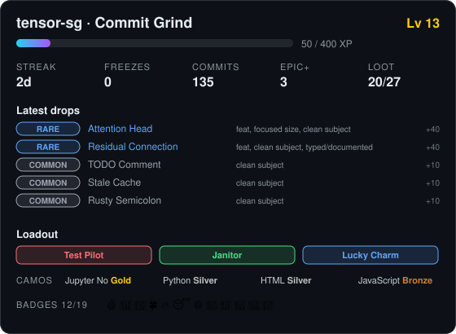

# Hi, I'm SAGE 👋

Building neural networks in PyTorch, from the training loop up.

### 🛠️ Building
**🫀 ECG anomaly detection**
LSTM trained from scratch on heart-rhythm signals to flag anomalous beats.
Exposed as a tool to an LLM, with Qdrant retrieval for context.

**🤖 FSM tool-calling agent**
Agent loop written as an explicit finite-state machine over raw LLM API calls. No framework.
Qdrant for memory, served with FastAPI. Eval harness in progress.

### 🔬 Exploring
- **Non-classical logic based neural networks**
  - Networks grounded in paraconsistent, many-valued and fuzzy logics instead of binary true/false
  - Belnap's four-valued logic (true / false / both / neither) and annotated evidential logic (Eτ) as a basis for neuron design
- **Inconsistent data modelling**
  - Treating contradiction in data as signal, not noise to be cleaned away
  - Keeping evidence *for* and *against* separately instead of collapsing both into one probability
  - Telling genuine conflict between sources apart from plain label noise
- **Paraconsistent learning**
  - Training objectives and inference that stay meaningful when the data contradicts itself
- **Uncertainty modelling**
  - Epistemic vs. aleatoric uncertainty, calibration, evidential deep learning
- **Graph neural networks**
  - Message passing, relational inductive biases, reasoning over knowledge graphs
- **Neuro-symbolic AI**
  - Logic as differentiable constraints (e.g. Logic Tensor Networks), rule extraction from trained models

### ⚙️ Tools
PyTorch · Python · Qdrant · LangGraph · FastAPI

### 🎮 Commit log
<!-- GRIND:START -->

🎽 Perks

| Slot | Perk | Effect | Unlock |
|---|---|---|---|
| red | ✅ Test Pilot **(equipped)** | +25% XP on tested commits | 10 commits with tests |
| red | 🔒 Bug Hunter | +40% XP on fix: commits | 15 fix: commits |
| red | 🔒 Clean Hands | +15% XP on conventional commits | 20 conventional commits |
| green | 🔒 Torchbearer | +30% XP on ML commits | 10 ML commits |
| green | ✅ Janitor **(equipped)** | +50% XP on refactors | 5 net-deletion refactors |
| green | ✅ Scholar | +50% XP on docs commits | 10 commits touching docs |
| blue | ✅ Lucky Charm **(equipped)** | Lucky-drop chance 5% → 12% | Reach level 10 |
| blue | ✅ Architect | Epic+ drops give 2× XP | 3 Epic-or-better drops |
| blue | 🔒 Momentum | +2% XP per streak day (max +20%) | Best streak of 14 days |

🏅 Badges

- 🩸 **First Blood** — First tracked commit
- 💎 **Quality Control** — Earn a Rare commit
- 🔮 **Epic Moment** — Earn an Epic commit
- 🔒 **Touched by Gold** — Earn a Legendary commit
- 🔒 **Six Eyes** — Earn a Mythic commit (score 13+ with tests)
- 🍀 **Lucky Break** — Get a lucky tier bump
- 🔥 **Warming Up** — 3-day streak
- 🔒 **Locked In** — 7-day streak
- 🔒 **Domain Expansion** — 30-day streak
- 😴 **Well Rested** — Come back after a day off
- 🔒 **Early Bird** — Commit between 5 and 8 AM
- 🌐 **Polyglot** — Commits in 3+ languages
- 🧭 **World Traveller** — Commit to 5 repos
- 💯 **Centurion** — 100 commits
- 🎒 **Hoarder** — 10 unique loot items
- 🔒 **Completionist** — Every loot item
- 🎽 **Fully Kitted** — Unlock a perk in all 3 slots
- 🥇 **Gold Plated** — Unlock a Gold camo
- 🔒 **Prestige** — Pass level 100

🎒 Loot binder

- **Common** (7/7): Rusty Semicolon ×11, Stale Cache ×11, Print Debugger ×14, Lint Warning ×12, Untyped Variable ×9, TODO Comment ×6, Requirements.txt ×10
- **Uncommon** (6/6): Batch Normalizer ×6, Dropout Mask ×10, Learning Rate Scheduler ×12, Docker Layer, Clean Docstring ×7, Type Hint Charm ×2
- **Rare** (5/5): Attention Head ×5, Residual Connection ×6, Gradient Clipper ×3, Mixed Precision Core ×5, Vector Index Shard ×4
- **Epic** (2/4): Flash Attention Kernel, LoRA Adapter ×2
- **Legendary** (0/3): —
- **Mythic** (0/2): —

<!-- GRIND:END -->

---
5+ years of production Python · MSc Data Science · [LinkedIn](https://www.linkedin.com/in/priyatosh-s-09b2461b3/)
